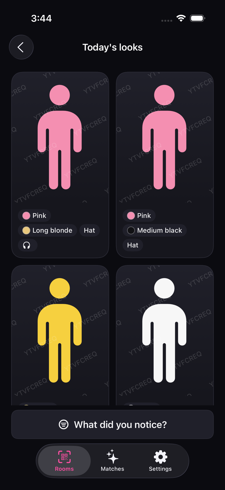
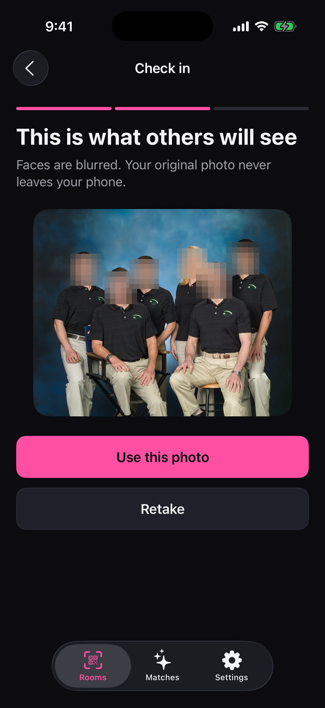
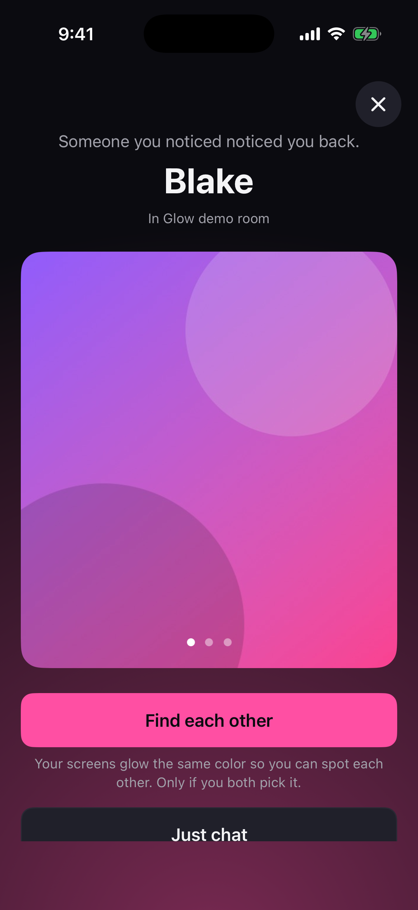
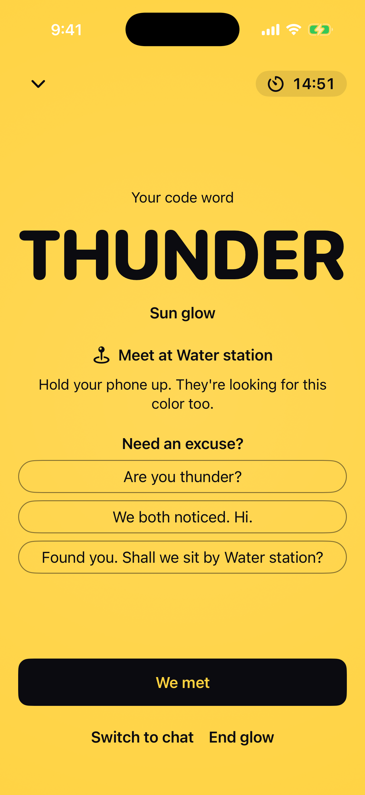

# Glow

**Find out, privately, that you noticed each other.** Glow is an iPhone app for a room full of people: a hackathon, a conference, a class. You tap the person you noticed. They're never told unless they tapped you too. If it's mutual, both screens light up in the same color with the same code word, so you can find each other across a loud hall.

Built at Cal Hacks by David Xie and Robin, with a team of Claude Code agents.

<p>
  
  
  
  
</p>

## What it does

1. **Join a room** by scanning its QR code. The phone checks once that you're inside the venue, then keeps only pass or fail, never your location.
2. **Check in** with a photo of today's outfit. Faces are blurred on the phone before the photo is uploaded. Add a few tags (top color, hair, glasses).
3. **Pick what you noticed** and browse a small deck of "today's look" cards: no names, no faces, no distances.
4. **Tap** the one you noticed. They aren't told. You get 3 taps per room per day.
5. **If they tapped you too,** both phones buzz and each of you sees the other's profile for the first time.
6. **Find each other or Just chat.** If both pick Find, both screens go to full brightness in the same color with the same code word and a meeting spot for 15 minutes, with a lock-screen countdown. The code word is the excuse to say hi.

There is no rejection: a one-sided tap is never shown to anyone, and it expires in 24 hours. Block, report, pause and delete-account are built in, and organizers get an admin web with rooms, printable posters, a rotating-QR display screen and a review queue.

## How it works

- **The rules live in Postgres.** Who appears in your deck, the tap cap, one match per pair, blocks both ways and expiry are security-definer functions with row-level security on every table and no client policies, so a bug in a route can't skip them. Simultaneous taps take an advisory lock on the pair: a pgTAP test fires 50 pairs tapping each other at once and checks for exactly 50 matches.
- **Privacy rules with tests.** Twelve invariants (P1 to P12 in [`AGENTS.md`](AGENTS.md)) each have an owner and an automated test. Before a mutual match, nothing the app receives carries another person's ID, name or face. Coordinates are never stored or logged. Asking for something you can't see returns 404, never 403, so its existence doesn't leak.
- **Private images.** Vision finds faces on the phone, each box grows 30% and is blurred and pixelated, and a second pass catches survivors; the upload stops if a face survives twice. The server re-encodes the photo and strips its metadata. Cards are served only through signed links that last 60 seconds, are bound to one viewer, and carry a faint watermark of that viewer's code, so a leaked screenshot can be traced.
- **Rotating QR.** A screen's QR code is an HMAC-SHA256 of a 30-second window, compared in constant time; a photo of the screen stops working. A QR only gets you to the location check, never into the room by itself.
- **One contract, two clients.** [`contracts/openapi.yaml`](contracts/openapi.yaml) (52 operations) generates the Swift client and the TypeScript types and zod schemas. CI fails if generated code is stale, and the generator refuses a response shape that could carry a user ID.
- **The glow.** One of 300 hand-picked code words plus a color, unique among active glows in the room, on a flash-safe pulse that only brightens.
- **Built by agents in waves.** About 24 Claude Code agents built it in parallel, each owning one module and working against the contract, coordinated by an integrator agent. The rulebook is [`AGENTS.md`](AGENTS.md); decisions and hand-offs are in [`docs/DECISIONS.md`](docs/DECISIONS.md) and [`docs/HANDOFFS.md`](docs/HANDOFFS.md).

## Tech stack

- **iPhone:** Swift 6, SwiftUI, iOS 17+, Vision, ActivityKit (Live Activity), Core Haptics, CoreLocation, supabase-swift (Auth and Realtime), swift-openapi-generator, XcodeGen, swift-snapshot-testing
- **Server:** Next.js 16 and React 19 in TypeScript, zod, sharp, jose with Node http2 for Apple push, Anthropic SDK for photo and chat moderation, Upstash rate limits, Vitest
- **Database:** Supabase (Postgres, Auth, Storage, Realtime), pgTAP

## Running locally

Requirements: macOS with Xcode 26, Node 24 and pnpm, Docker (for the local Supabase), the Supabase CLI, and `brew install xcodegen swiftlint swiftformat`.

```bash
pnpm install
pnpm db:start        # local Supabase on ports 54420 to 54424
pnpm env:setup       # writes server/.env.local with fresh local secrets
pnpm dev             # API and admin web on http://localhost:3000
```

The iPhone app runs on two Simulators, Glow A and Glow B, so one Mac can play both people in a match:

```bash
scripts/sim.sh setup && scripts/sim.sh build && scripts/sim.sh install
scripts/sim.sh at venue     # move both Simulators to the seeded demo room
scripts/sim.sh photos       # add fixture outfit photos to both photo libraries
scripts/sim.sh scan demo    # open the demo room's link, as if its QR was scanned
```

Tests:

```bash
pnpm check                  # server: typecheck, lint, format check, Vitest
pnpm db:test                # database: pgTAP
scripts/sim.sh test         # iOS unit and UI tests on Glow A
scripts/e2e/run.sh full     # end to end: check in, tap, mutual, Find, glow, We met
```

The full end-to-end journey needs a server with test sign-in on (`pnpm env:setup --force --test-login`). Every command is listed in [`AGENTS.md`](AGENTS.md#commands).

## Status

Everything above runs on iOS Simulators against a local Supabase: the full loop passed 10 runs in a row on one Simulator, with person B played by a script, and [`docs/shots/d1-e2e-full.mp4`](docs/shots/d1-e2e-full.mp4) records it on two Simulators. It has not run on a real iPhone or a deployed server yet: there is no cloud project, push needs an Apple Developer account, and moderation uses a deterministic stand-in until an Anthropic key is set. [`docs/STATUS.md`](docs/STATUS.md) tracks what is proven and what isn't.

A second mode, **Blind** (swipe on photos only, then chat under codenames until both choose to reveal), and a design refresh live on the `blind-mode` branch.

## Docs

[`docs/SPEC.md`](docs/SPEC.md) (product and technical spec) · [`docs/BUILD_PLAN.md`](docs/BUILD_PLAN.md) (agent waves) · [`docs/SECURITY_REVIEW.md`](docs/SECURITY_REVIEW.md) (red-team findings) · [`docs/DEMO.md`](docs/DEMO.md) and [`docs/PITCH.md`](docs/PITCH.md) (demo kit) · [`docs/RELEASE.md`](docs/RELEASE.md) (TestFlight pipeline)
