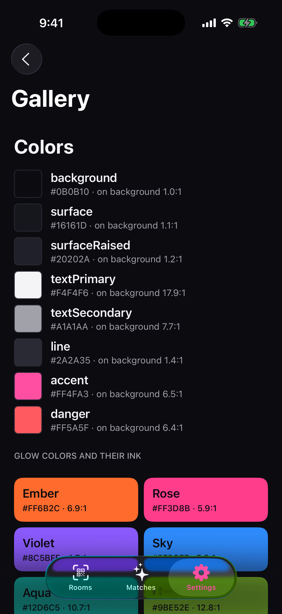

# DesignSystem

Glow's colors, type, spacing, motion, components, glow surface and haptics. Owner: B6. Every
feature module imports it, and SwiftLint stops features from defining their own colors or fonts.



The Gallery shows every component in every state: **Settings > Debug > Gallery** in a Debug build.
Its sections are also snapshot tests, at the default text size and the largest accessibility size.

## Colors

```swift
Text("Hi").foregroundStyle(.glowTextPrimary)        // also .glowTextSecondary
VStack { … }.background(.glowBackground)            // .glowSurface (cards, sheets), .glowSurfaceRaised
Divider().overlay(.glowLine)
Image(systemName: "heart").foregroundStyle(.glowAccent)   // .glowDanger for block, report, delete
```

Text on an accent or danger fill is `.glowOnAccent` (dark: white on pink fails contrast, B6-D2). The
exact values are in `GlowPalette` (`GlowPalette.accent.hex == "#FF4FA3"`). Never `Color(...)`,
`UIColor` or `.foregroundStyle(.white)` in a feature: ask B6 for a token.

**Glow colors**: `GlowHue(rawValue: glow.color.rawValue)`, then `hue.color`, and `hue.ink` for any
text on it (B6-D1). **Tag dots**: `GlowSwatch(rawValue: tags.topColor.rawValue)` with `GlowSwatchDot`.

## Type

```swift
Text("Pick what you noticed").glowFont(.title)
Label("Glasses", systemImage: "eyeglasses").font(.glow(.callout))
```

`display`, `title`, `headline`, `body`, `callout`, `button`, `chip`, `footnote`, `caption`, `code`,
`codeWord`. All scale with Dynamic Type. Never `.font(.title)` or `Font.system` in a feature.

## Spacing, corners, motion

`GlowSpacing.xxs` (4) to `.xxl` (48) on a 4-point grid, `.screenMargin` (20). `GlowRadius.control`
(12) and `.card` (20); chips are `Capsule()`. Animate with `.glowAnimation(.ui, value: x)` (0.2 s
ease-out) or `.glowAnimation(.reveal, value: x)` (a spring), both of which follow Reduce Motion.
Transitions: `GlowMotion.transition(from: .top, reduceMotion:)`.

## Components

| Need | Use |
| --- | --- |
| Buttons | `.buttonStyle(.glowPrimary)`, `.glowSecondary`, `.glowQuiet`, `.glowDanger`, `.glow(.primary, size: .compact)`; `.glowLoading(isSending)` |
| A toggle chip | `GlowChip("Glasses", systemImage: "eyeglasses", isSelected: on) { on.toggle() }` |
| Tag picker | `GlowTagPicker("Extras", options: CardExtra.allCases, selection: $extras, limit: 3) { GlowTag($0.name, systemImage: $0.symbol) }`, or `selection: $topColor` (one) |
| Wrapping rows | `GlowFlowLayout { … }` |
| A deck card | `GlowCardTile(phase: .ready, tags: tags, isNoticed: tapped, accessibilityLabel: Text(…)) { photo } watermark: { GlowWatermark(viewerCode) }` |
| Hide while recorded (P12) | `.glowHiddenWhenCaptured()`; fake it in tests with `.environment(\.isSceneCaptured, true)` |
| Bottom sheet | `.glowSheet(isPresented: $show) { GlowSheetContent(title: "…", message: "…") { buttons } }`; for a Route sheet, `.glowSheetPresentation()` |
| Toast | `.glowToast($toast)`, then `toast = GlowToastMessage(String(localized: "Saved"), kind: .success)` |
| Code entry | `GlowCodeField("Room code", code: $code, length: GlowConstants.ROOM_CODE_LENGTH, format: .roomCode) { submit($0) }` (`.digits` for email codes) |
| Step header | `GlowStepHeader(step: 2, of: 4, title: "Add your photos", subtitle: "…")` |
| Empty state | `GlowEmptyState(systemImage: "sparkles", title: "Nobody fits that yet.", message: "Try fewer details.") { button }` |
| Full-screen takeover | `GlowTakeover(.bloom) { … } onClose: { … }` (also `.night` and `.hue(.aqua)`) |

## The glow

```swift
GlowSurface(hue) {
    VStack(spacing: GlowSpacing.lg) {
        GlowCodeWord(session.codeWord)
        Text("Meet at \(spot)").glowFont(.headline)
        Button("We met") { … }.buttonStyle(.glowOnSurface)
    }
}
```

`GlowSurface` fills the screen with the color and a soft bloom that pulses every 1.25 s (a slow 4 s
fade under Reduce Motion). It never darkens, so text stays above 4.5:1 throughout, and the dimmest
moment is never under 70% of the brightest (B6-D3). While it's on screen it turns brightness all the
way up and keeps the screen awake, and puts both back when it leaves, when the app goes to the
background, or when Control Center opens. Use `.glowFullBrightness()` and `.glowKeepAwake()` on
their own for anything else that needs them.

## Haptics

```swift
.glowHaptic(.lightTap, trigger: tapCount)     // .selection, .success, .warning
.glowHaptic(.mutual, trigger: matchID)        // the mutual moment
GlowHaptics.shared.play(.glowPulse)           // three soft beats in time with the glow
```

The Simulator plays no haptics; check them on a device.

## Rules of thumb

- Every text and background pair a component draws is listed in `GlowPalette.textPairings` and
  tested against WCAG AA. Add a line when you add one.
- Everything scales with Dynamic Type. Check new screens at the largest size.
- Ask under **For B6** in `docs/HANDOFFS.md` for anything missing.
